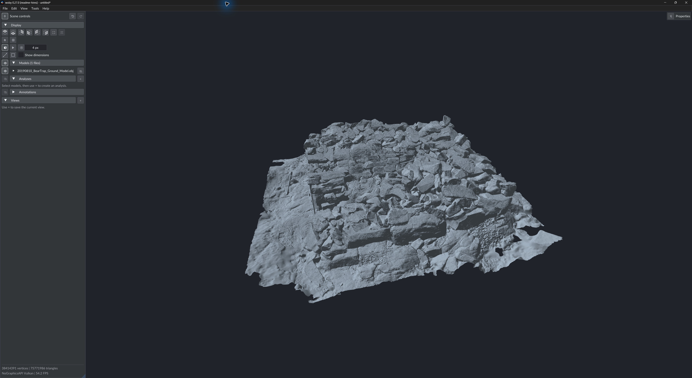
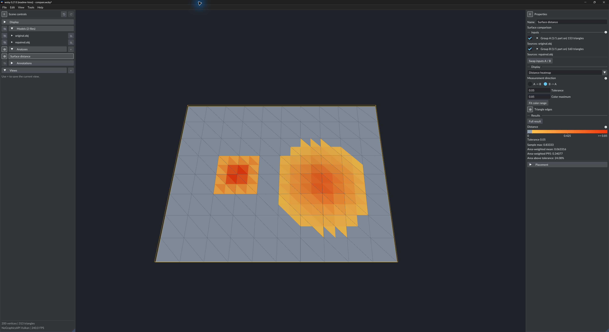
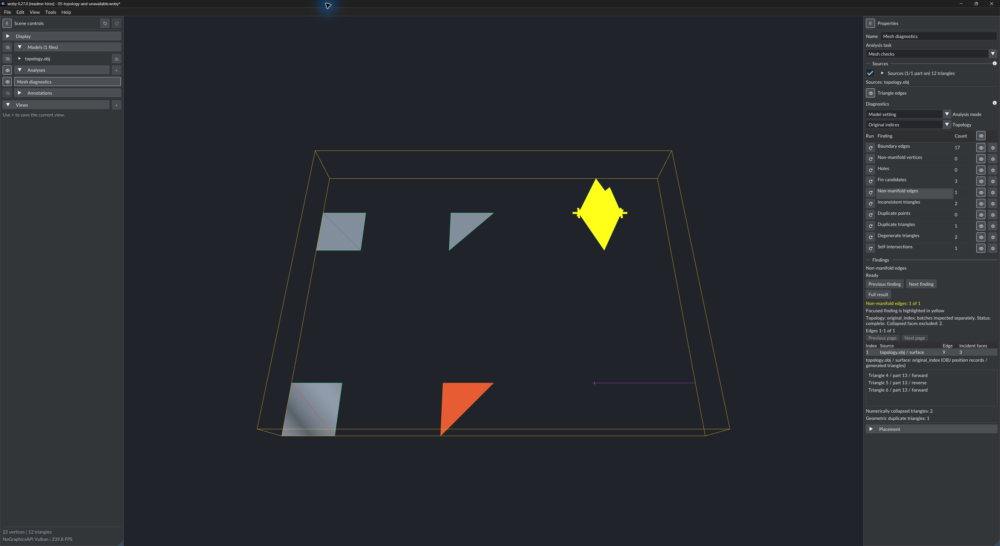
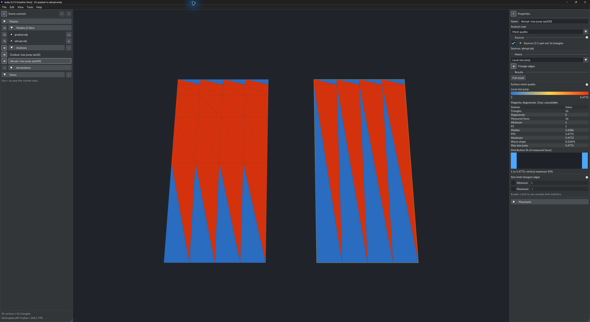
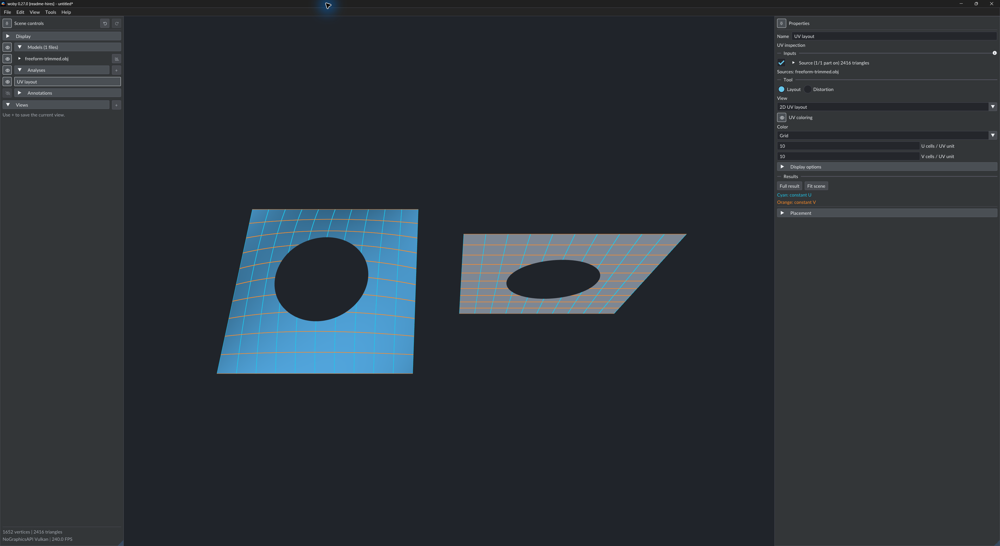
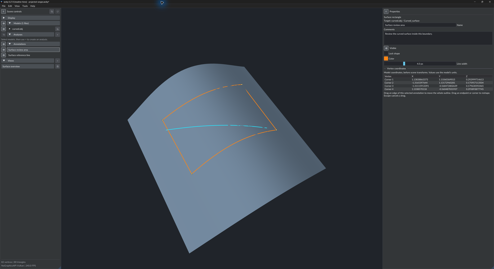

# woby

woby is a desktop application for viewing and analyzing 3D geometry.

## Features

- **Supports obj file format:** Triangular meshes, polygon meshes, point clouds and OBJ freeform geometry including Bézier and B-spline/NURBS curves and surfaces, with trim boundaries and holes.
- **Importers:** Write your [importers](doc/importers.md) to support any file format.
- **VTK tetrahedral meshes:** Load [ASCII unstructured grids](doc/vtk-meshes.md) with 4-node and 10-node tetrahedra. Importers can also return these cells. No VTK library is required.
- **Tetrahedral quality:** Measure cell volume, shape, and dihedral angles. Check the full quadratic Jacobian, inspect interior cells, and export cell results.
- **AI support:** Tell your AI where to find woby executable, it will figure out the rest. CLI based http server that can do anything and everything in one or more woby instances.
- **Surface comparison:** Create named analyses with A/B inputs, overlays, and distance heatmaps. Set tolerances and color ranges. Results include maximum, mean, P95, and area statistics. Distances are approximate and unsigned. Measurements use the model coordinate units.
- **Mesh diagnostics:** Find boundary edges, winding edges, non-manifold edges and vertices, duplicates, degenerate triangles, holes, fin candidates, and self-intersections. Select findings to show them in the viewport.
- **Surface mesh quality:** Examine triangle size, shape quality, and local size changes. Results include histograms, percentiles, and comparisons with specified size limits.
- **Thin regions:** [Measure surface-based volume thickness](doc/thin-regions.md) before FEM meshing. Inspect thin regions, thickness maps, and preliminary element-size limits.
- **UV inspection:** Examine an existing 2D UV layout or a 3D surface grid. Measure distortion, stretch, orientation, and overlaps. Select linked points in the source and analysis. Woby does not create UV coordinates.
- **Annotations:** Draw lines and rectangles on surfaces. Place text in the scene. Change text, color, and size. Keep text facing the camera or use a fixed rotation. Save annotations with the scene.
- **Saved states:** Save named Views and `.woby` scenes. Use Undo/Redo for scene changes, object additions and removals, and analysis settings.
- **Model and part names:** Select one model, group, or part. Press F2 or use Rename in its context menu, or edit Name in Properties. Use Restore original name to reset that item. Custom names support Undo/Redo and are saved in the `.woby` scene. Source files stay unchanged.
- **Recent files:** Use File > Recent scenes or File > Recent models to open a file again. Each list keeps up to 20 files. Right-click an entry to remove it, or use File > Clear recent history to clear both lists.
- **Windows file associations:** In Settings, select `.woby` scenes or `.obj` models to add this copy to Open with. Use Windows defaults to select the default app. Registration applies to the current user and does not require administrator rights. If you move the portable folder, select the file types again to register the new copy. Clear the checkboxes before deleting a registered copy.
- **Export and automation:** Export PNG images at a specified resolution. Include analysis legends and labels if necessary. Export diagnostic results as JSON. Use the [CLI and local API](doc/ctl-commands.md) to control an active viewer.

Recent file history is saved for each user. On Windows, the file is `%LOCALAPPDATA%\woby\recents.json`. On macOS, it is `~/Library/Application Support/woby/woby/recents.json`. On Linux, it is `$XDG_STATE_HOME/woby/recents.json`, with `~/.local/state/woby/recents.json` as the default. History is separate from saved scenes and Undo/Redo. Headless sessions do not update it.

Use Ctrl-click to select multiple rows. Use Shift-click to select a range of
expanded rows. Right-click keeps the selection and adds the clicked row if
necessary. The context menu shows how many items an operation affects. Use
**Select all in this list**, or press Ctrl+A with the pointer over the list.
Press Delete to apply the Delete or Remove action to the selected rows in the
last clicked list. This works with one or more selected rows. Delete does not
remove items while you edit text or use a dialog or context menu.

Bulk menus are available for models, analyses, annotations and cross sections,
analysis inputs, detector checks, model file removal, and saved Views. Each scene
edit uses one Undo step. File removal affects the scene; it does not delete files
on disk. In Views, Ctrl-click and Shift-click select rows without restoring a
view. A normal click restores the view.

## Requirements

| GPU and system | Driver version | Source information |
| --- | --- | --- |
| NVIDIA on Windows | Vulkan developer beta **595.92** | This release added device-address commands. Earlier releases added descriptor heaps and untyped pointers. Refer to the [NVIDIA release history](https://developer.nvidia.com/vulkan-driver). |
| NVIDIA on Linux | Vulkan developer beta **595.44.03** | This release added the same feature on Linux. Refer to the [NVIDIA release history](https://developer.nvidia.com/vulkan-driver). |
| AMD on Windows | Adrenalin **26.6.1**, with applicable RDNA 3 or later hardware | This is the first listed regular release with descriptor heaps and device-address commands. Preview **25.30.17.02** added descriptor heaps only. Refer to the [AMD Vulkan release history](https://www.amd.com/en/resources/support-articles/release-notes/rn-rad-win-vulkan.html). |
| AMD on Linux | **Mesa RADV 26.2.0** or later | This release enables descriptor heaps by default. Refer to the [Mesa 26.2 release notes](https://docs.mesa3d.org/relnotes/26.2.0.html). |

The x64 CPU minimum is AVX2. The operating system must enable AVX register state.
The Mac hardware minimum is Apple M1 or newer. Mac builds use ARM NEON.

Every x64 build includes AVX-512 coordinate rebasing. Woby selects it automatically
when the CPU and operating system support the required instructions and register
state. Other x64 systems use AVX2. No build option is needed.

| GPU and system | Minimum feature generation | Examples |
| --- | --- | --- |
| NVIDIA on Windows or Linux | Turing | GeForce GTX 1630, GTX 1650, GTX 1660, and RTX 2060. Later RTX generations also have the necessary architecture. GTX 10-series/Pascal does not have the necessary features. |
| AMD on Windows | RDNA 3 | Radeon RX 7600. Renderer reports also include Radeon 700M integrated graphics. |
| AMD on Linux with RADV | RDNA 2 | The AMD GPU in the Steam Deck. Radeon RX 6400 and RX 6600 are desktop candidates from this generation. |

## Screenshots

**Large models**

The Bear Trap ground model contains **75,771,986 triangles** and **38,414,391 vertices** in a 7.11 GB OBJ file. The lower-left status area shows the geometry counts and live FPS.

This capture shows **54.2 FPS** with solid rendering at **3840 × 2071** and 4× MSAA. It uses woby 0.27.0, a Release build, on Windows with an NVIDIA GeForce RTX 3070 Laptop GPU and an AMD Ryzen 7 5800H.

[](doc/screenshots/beartrap-fps.png)

**Surface comparison**

Compare an original surface with a repaired surface. The distance heatmap shows the changed areas. The Properties pane shows the tolerance, color range, and distance statistics.

[](doc/screenshots/surface-comparison.png)

**Mesh diagnostics**

Find topology errors and select a finding to highlight the affected geometry. This sample shows a selected non-manifold edge, detector counts, and controls to move between findings.

[](doc/screenshots/mesh-diagnostics.png)

**Surface mesh quality**

Compare gradual and abrupt changes in triangle size. The selected result shows local size-jump statistics and a distribution histogram. Each result uses its own color range.

[](doc/screenshots/mesh-quality.png)

**Freeform geometry and UV inspection**

Inspect a trimmed Bézier surface with a circular hole beside its 2D UV layout. Cyan lines show constant U values; orange lines show constant V values.

[](doc/screenshots/uv-inspection.png)

**Surface annotations and saved views**

Add lines, review areas, and comments to a surface. Select an annotation to edit its shape and appearance. Save a named view to return to the same scene settings and camera position.

[](doc/screenshots/surface-annotations.png)

## Development tests

Local and CI builds use upstream **Clang 23.1.5**. Install that LLVM release,
including `clang-cl` on Windows. Windows still requires Visual Studio 2026 C++
tools and the Windows SDK. macOS requires the Xcode 26 SDK and Metal tools.
The C++ standard library stays platform-specific: MSVC on Windows, libstdc++
on Linux, and Xcode's matching libc++ headers and runtime on macOS.

On Windows, the presets select `C:/Program Files/LLVM`. For another installation,
set `WOBY_LLVM_ROOT` to the LLVM directory before configuring. On Linux and macOS,
set the same variable to select upstream LLVM. Apple Clang does not satisfy the
version check. Both Woby and vcpkg dependencies use this compiler. The dependency
baseline in `vcpkg.json` must match `cmake/ci-vcpkg-revision.txt`.

The vcpkg presets use a repository-local `.vcpkg` checkout. Prepare it once:

```powershell
git clone https://github.com/microsoft/vcpkg.git .vcpkg
git -C .vcpkg checkout --detach (Get-Content cmake/ci-vcpkg-revision.txt).Trim()
.vcpkg/bootstrap-vcpkg.bat -disableMetrics
```

On Linux and macOS, check out the same revision and run `bootstrap-vcpkg.sh`.

The preset names now use separate `build/<preset>-clang` directories.
The old MSVC build directories can remain on disk. To verify an installation,
run `uv run .github/scripts/setup_llvm.py --root "C:/Program Files/LLVM"`.
CI downloads packages and checks their SHA-256 hashes from
`cmake/llvm-toolchain.json`.

Build the Debug configuration, then run the CPU, slow, and graphics suites separately:

```powershell
cmake --preset vs2026-vcpkg
cmake --build --preset vs2026-vcpkg
ctest --preset vs2026-vcpkg
ctest --preset vs2026-vcpkg-slow
ctest --preset vs2026-vcpkg-graphics
```

The presets use four CTest jobs. CPU tests run in source-file groups. Slow cases run separately and are excluded from their file groups. Graphics tests share a resource lock. Enable `WOBY_TEST_HEADLESS` at configuration time to include the headless rendering tests.

Use `ctest --preset vs2026-vcpkg -R scene_history` to run a file group. To run one case, call `build/vs2026-vcpkg-clang/bin/Debug/woby_tests.exe --test-case="case name"`. Individual case names and source locations remain in failure output. CI uses Ninja and the same three suite filters.

### System boundaries

File Associations is the first source system. Its public headers are in
`src/file_associations/api`; its implementation and Windows
registry header are in `src/file_associations/internal`. Callers include
`<file_associations.h>`. The existing link targets remain in use.

`systems.toml` declares API dependencies, implementation dependencies, and the exact
unit-test files that may use a system's internals. Unmigrated code has a temporary
`legacy` identity. It may use the File Associations API, but not its internal headers.
The implementation's dependency on `legacy` permits the existing UTF-8 path utility
and the settings-dialog tests. This is a migration boundary, not a complete division
of the application into systems.

CMake generates Clang module maps and assigns a module identity to each source file.
Normal builds reject private includes and undeclared system dependencies. This uses
textual headers; it does not enable compiled C++ modules. Clang also records the actual
compile commands, including when the Visual Studio generator is used.

To build and run the complete check:

```powershell
cmake --build --preset vs2026-vcpkg --config Release --target woby_check_systems
```

After a build, the same checker can run directly:

```powershell
uv run tools/check_systems.py check --build build/vs2026-vcpkg-clang --config Release
```

Use `--llvm-root` for an LLVM installation outside `WOBY_LLVM_ROOT` or the default
Windows location. The pinned distribution must include `clang-tidy` and
`clang-scan-deps`. Both checker tests are part of the normal CTest development suite,
so CI runs them with its Ninja build.

The checker scans each built C++ source in the manifest's roots, compiles each public
header independently, and uses Clang's declaration locations to reject internal
function, variable, member, and type references. The semantic checks run on sources
whose dependencies include internal files. This includes indirect header paths and function addresses. Only
explicitly named unit tests receive internal access. A missing compile command fails
the check; build that configuration first.

These checks cover active preprocessor branches. Platform CI supplies the other
platform configurations. The first checker does not track state mutations or detect
hand-written declarations of internal functions that omit their defining header.
