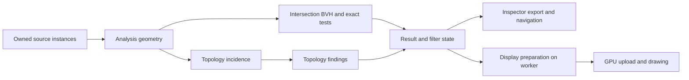

# Separate analysis geometry topology findings and display

Separate the intersection input from full topology first. The current intersection worker builds edge incidence, connected components, topology findings, and topology display buffers that it does not use. Reusing compatible source geometry is the clearest first change. Splitting every detector and display cache at once has a higher cost and more failure cases.

This investigation applies to production commit `56b3102`. The subsequent [implementation report](analysis-stage-separation-implementation.md) records the changes and their measurements. The initial isolated probe used the production functions at that commit and did not change the application analysis path. The [probe source](../experiments/analysis-stages/main.cpp) has since been extended to measure the implementation. The raw results below preserve the initial executable and source hashes.

## Current dependencies

`computeComparisonStages` calls `inspectSurfaceTopology` for an intersections-only request. That call builds `MeshTopology`, then converts boundary and winding findings into lines and prepares vertex markers, hole edges, and fin fills. `inspectIntersections` reads source positions, face vertex IDs, face references, source identity, topology mode, and availability counts. It builds its own bounding-volume hierarchy, or BVH. It does not read topology edges, incidence spans, components, vertex-link findings, boundary regions, or fin patches.

The extra topology remains in the worker result until publication. `applyComparisonStages` transfers only intersection findings, bounds, and edges for an intersections-only stage. It discards the topology and its overlays. When a topology result already exists, the runtime intersection job still captures the prepared input meshes and calls the same stage function. It does not capture or reuse the completed graph. Changing intersection budgets also invalidates the intersection result and starts this path again.

Sources: [stage execution and publication](../src/mesh_comparison.cpp), [intersection input and BVH](../src/mesh_intersections.cpp), [worker scheduling](../src/comparison_runtime.cpp).

Some useful separation already exists:

- `MeshGeometry`, topology source graphs, and flattened incidence storage have shared immutable owners. A topology snapshot does not deep-copy the source graph.
- Prepared comparison input meshes are cached. The runtime does not rebuild the world render mesh for every detector job.
- Hole and fin thresholds filter existing results without rebuilding the graph.
- Result export excludes render buffers and distance samples.
- Geometry invalidation releases old topology before replacement. A new cache must preserve that memory policy.

Sources: [topology owners](../src/mesh_topology.h), [runtime source cache](../src/comparison_runtime.h), [threshold filtering and invalidation](../src/mesh_comparison.cpp), [export snapshots](../src/analysis_results.cpp).

## Proposed products

| Product | Owns | Needed by |
| --- | --- | --- |
| Analysis geometry | Selected source instances, validated transformed double positions, mode-specific vertex identities, surviving face IDs, source references and availability | Intersections and topology; later other compatible detectors |
| Topology incidence | Edge uses, vertex adjacency, face-edge links, connected components | Boundary, winding, vertex-link, hole and fin inspection |
| Findings and filters | Detector results, provenance, stable order, completeness and budget status; threshold selections | Inspector, control API, export and navigation |
| Display data | Requested lines, markers, fills and GPU buffers | Rendering |



Use structs and free functions. Keep these products in runtime storage, with immutable ownership across worker boundaries. The logical user controls can remain in `UiState`. Geometry must not hold a pointer back to a full incidence graph. Otherwise, retaining a small intersection input would keep the full graph alive.

For the first compact geometry format, preserve the current identity types: 24 bytes per double position and 48 bytes per face for three `size_t` vertex IDs and its source reference. The current `TopologyVertex` also contains four spans; `TopologyFace` also contains edge IDs and a component ID. Move these extra columns into incidence rather than copying them into the geometry product. Point-reference lists used in topology reports must remain available when required.

## BusGameMap measurements

The Release probe loaded 1,054,542 render faces. It selected all parts into one source batch with identity transforms and used the default intersection budgets. Each topology mode ran three samples in a fixed order in one process; no warmup was excluded. Loading, result comparison and JSON output are outside the timings. No build or test ran during measurement. The [raw results](analysis-stage-separation-results.json) include model, executable and source hashes.

| Work | Original index | Exact position |
| --- | ---: | ---: |
| Build full topology | 0.834 s | 1.187 s |
| Current intersections-only stage | 4.246 s | 4.918 s |
| Inspect existing topology directly | 3.431 s | 3.756 s |
| Inspect geometry-only dependency projection | 3.420 s | 3.775 s |

Direct inspection of an existing graph avoids about **0.814 seconds (19.2%)** in original-index mode and **1.162 seconds (23.6%)** in exact-position mode relative to the current stage. This compares existing APIs; it is not an implemented end-to-end cache path. The direct call still builds the intersection BVH, but excludes the small bounds/edge preparation performed by the stage after finding intersections. The retained full topology remains resident during the repeated stage measurement, as it would when intersections are requested after topology.

Both modes returned **10,000 findings** and stopped at the **pair limit**. Candidate counts were 538,195 and 576,805 respectively. Full ordered finding data, face references, geometry, source/batch identity, availability counts and truncation status matched between the full topology, the geometry-only projection, and the production stage in each sample. This verifies bounded results on this model, not an unlimited intersection scan.

The dependency projection retains only the fields read by intersections, but still uses the current wide vertex/face structs. It removes edge incidence, components, topology findings and point-reference lists. It is a proof of the dependency boundary, not a new compact builder or a measurement of its cold-start time. Its inspection time is close to direct inspection of the complete graph; the gain comes from avoiding graph construction.

| Retained array capacity | Original index | Exact position |
| --- | ---: | ---: |
| Vertex records | 44.97 MiB | 44.97 MiB |
| Face records | 80.46 MiB | 80.46 MiB |
| Edges | 60.65 MiB | 60.64 MiB |
| Incidence and point references | 105.09 MiB | 105.08 MiB |
| Components | 8.60 MiB | 8.63 MiB |
| Topology findings and filters | 8.81 MiB | 9.33 MiB |
| Total topology arrays | 308.59 MiB | 309.11 MiB |
| Proposed minimum intersection geometry payload | 60.53 MiB | 60.52 MiB |

The current topology arrays retain about **309 MiB**. Positions and face identities alone would need about **60.53 MiB**, an estimated **80.4% reduction in this part of the payload**. The estimate uses 24-byte positions and 48-byte face records; it excludes capacities, optional point provenance, metadata, source meshes, allocator overhead, temporary construction storage and the intersection BVH. It is not a measured process-memory or peak-memory reduction. Both modes retained 1,054,306 non-collapsed faces.

The intersections-only worker also built **4.46 MiB** of unrequested topology overlays in original-index mode and **4.35 MiB** in exact-position mode. The graph is the larger storage opportunity on this model. If all topology checks are requested, incidence and findings remain necessary, so the complete analysis cannot claim the same 80.4% reduction.

## Benefits and affected operations

| Operation | Expected benefit | Limit |
| --- | --- | --- |
| Run intersections after topology | Reuse the existing geometry; avoid a second graph and topology findings | Intersection BVH construction and exact tests still run |
| Run intersections first | Avoid incidence, components, unrelated findings and overlays | A new geometry builder must still validate, transform, identify and filter source faces |
| Change intersection budgets | Reuse compatible geometry | Partial results must keep the same candidate order and budget rules |
| Run only boundary or winding checks | Later, skip unrelated vertex-link, hole and fin inspection | All six topology categories currently share one stage bit; status and scheduling need changes |
| Change hole or fin threshold | Prepare changed display buffers on a worker | Graph reuse already exists; do not claim another graph-build saving |
| Hide diagnostic overlays or export results | Later, omit or release unused display buffers | Hidden findings may still need bounds for navigation and source data for export |
| Pan, zoom or change the camera | No direct benefit from the geometry split | This proposal targets analysis and memory, not ordinary frame rendering |

`setComparisonTopologyInspectionSettings` currently calls display geometry preparation from the runtime update path. Moving that work to a worker can reduce pauses during threshold edits. `uploadSurface` also rebuilds some duplicate, degenerate and intersection overlay arrays on the graphics thread. Display preparation is therefore useful beyond the initial intersection optimization, but needs its own revision and readiness checks.

Sources: [threshold preparation](../src/mesh_comparison.cpp), [upload preparation](../src/comparison_gpu.cpp).

## Costs and correctness risks

**More lifetime and invalidation rules.** Each cached product needs an owner and a compatible key. Geometry keys must cover source content, selected part ranges, source and batch identities, effective transforms, coordinate frame, and topology mode. Findings add detector settings and limits. Display adds the finding/filter revision and display parameters. Hole thresholds and Show flags must not invalidate geometry. A worker may keep an old owner alive, but publication must still reject its result when inputs change.

**Identity is part of the algorithm.** Original-index mode separates identities by source index and transform. Exact-position mode welds by transformed double coordinates within a source batch. Both retain source face references and exclude exactly collapsed triangles. Replacing these rules with render-vertex IDs or float positions can turn valid shared contacts into reported intersections, or hide real overlap. Canonical source and face order also controls which pairs are returned under a budget; equality of final counts is not enough.

**Caching can raise steady memory.** An intersections-only job currently discards topology after publication. Retaining geometry will use more idle memory than retaining findings alone, even if it reduces the next job's peak allocation. Cache only the current compatible product per analysis first. Do not keep a compact geometry copy beside an existing full graph as a permanent design. During a full analysis, most incidence and findings are still needed, so the total saving will be smaller than for intersections alone.

**Lazy display has a visible cost.** Showing a hidden result may require preparation and upload. The UI must distinguish a valid detector result from a display that is still pending. A headless export must not require GPU readiness. Navigation bounds must not disappear merely because an overlay is hidden. Avoid many tiny allocations and avoid running all new layers concurrently; the current detector scheduler intentionally limits overlapping workspaces.

**Legacy diagnostics cannot simply be removed.** `inspectMesh` and surface quality also construct geometric indexing and adjacency. They use the batch partition and a numerical degeneracy threshold. Source topology uses exact collapsed-face filtering and may use original indices. The existing UI/control counts and quality neighbor rules depend on these differences. Share these paths only after proving compatible identity, partition and eligible-face rules.

Sources: [source construction and ordering](../src/mesh_topology.cpp), [shared-contact rules and budgets](../src/mesh_intersections.cpp), [legacy diagnostics](../src/mesh_comparison.cpp), [quality adjacency](../src/surface_mesh_quality.cpp), [result metadata and references](../src/analysis_results.cpp).

## Recommended order

1. Add a geometry-only input view for intersections. Reuse the existing immutable topology owner when its geometry key and mode match. Keep the current cold path as fallback. This provides the smallest change to test and measure.
2. Extract the shared source geometry builder. Build it without incidence for a cold intersection request. Preserve face identity, ordering, availability, exact filtering and cancellation. Upgrade to topology by adding incidence to the same owned geometry.
3. Separate topology findings by their actual dependencies. Start with edge findings versus vertex-link, boundary-region and fin inspection. Keep current result and control API behavior while changing internal scheduling.
4. Add worker-prepared display products with independent revisions. Keep bounds needed for navigation. Measure visibility-toggle latency and threshold-edit responsiveness before enabling lazy GPU allocation broadly.
5. Investigate common indexing with quality and legacy diagnostics separately. Defer eliminating the world render mesh until detector-only jobs can take owned source instances directly; on-screen comparison, picking and dimensions still need a source display representation.

Acceptance checks should compare complete ordered findings, face and point references, candidate counts, truncation reasons, both topology modes, source batches, instance transforms, shared contacts, duplicate and collapsed faces, cancellation, stale publication, export and navigation. Measure cold intersections, intersections after topology, reruns with changed budgets, all checks together, threshold edits, retained memory and peak memory. A faster warm run alone does not prove a faster cold path.

## Validation and reproduction

The complete Debug build and the Release probe build passed without warnings. All **77 unit test groups** passed, including the new dependency contract and eight graphics unit groups. The contract covers both modes, duplicate and collapsed faces, separate batches, a transformed instance, unavailable provenance, pair/candidate budgets, and pre-requested cancellation. Existing topology and intersection unit tests also passed. The probe does not establish concurrent invalidation or GPU behavior for a future refactor.

```powershell
$env:VCPKG_ROOT = 'C:\work\vcpkg'
$env:VULKAN_SDK = 'C:\VulkanSDK\1.4.357.0'
cmake --build --preset vs2026-vcpkg --config Debug
ctest --test-dir build/vs2026-vcpkg -C Debug -L unit --output-on-failure -j 4
cmake --build --preset vs2026-vcpkg --config Release --target woby_analysis_stages_probe
./experiments/analysis-stages/run.ps1 -Model 'D:\temp\obj_tests\uploads_files_2720101_BusGameMap.obj'
```

The probe is enabled with `WOBY_BUILD_BENCHMARKS`. BearTrap was not used for this investigation. These timings describe the one-batch BusGameMap workload; different batch partitioning and larger finding budgets can change the balance between preparation and exact intersection tests.
