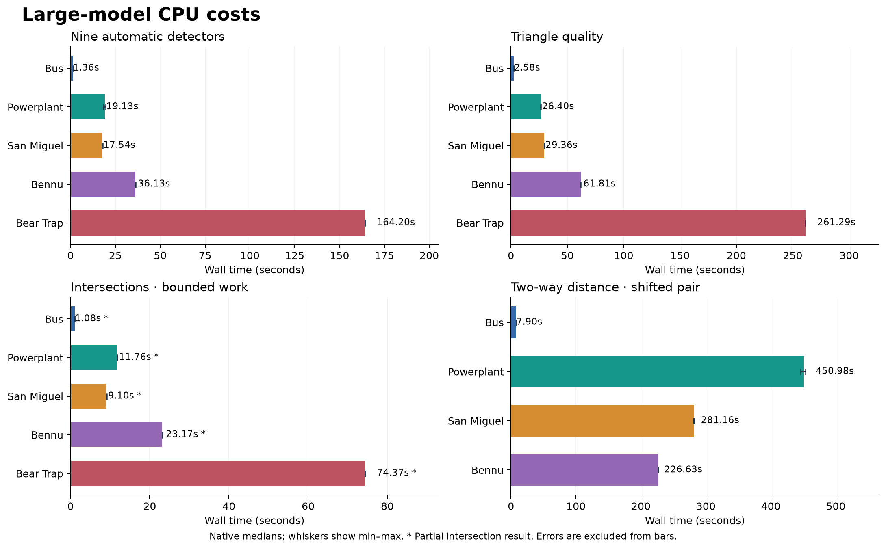
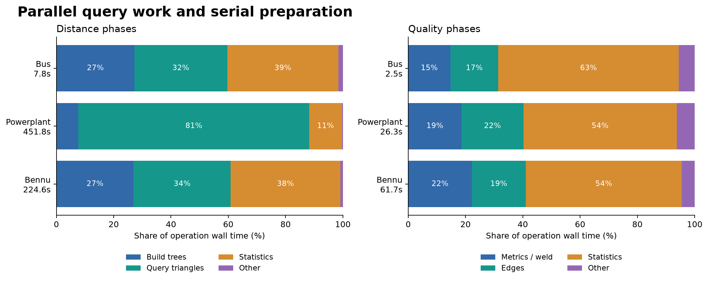
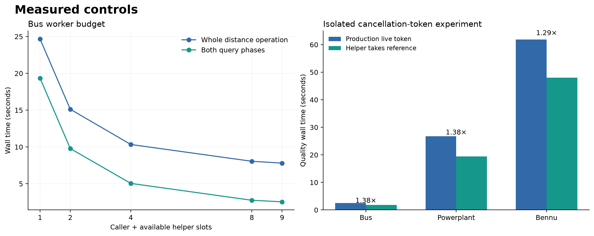
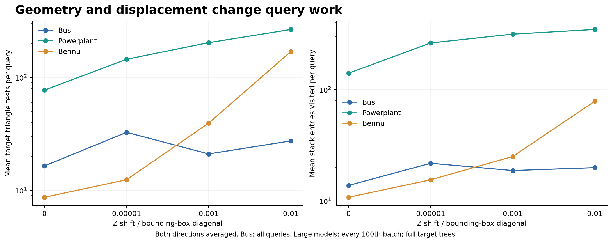
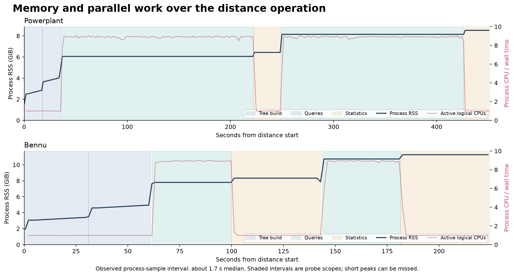
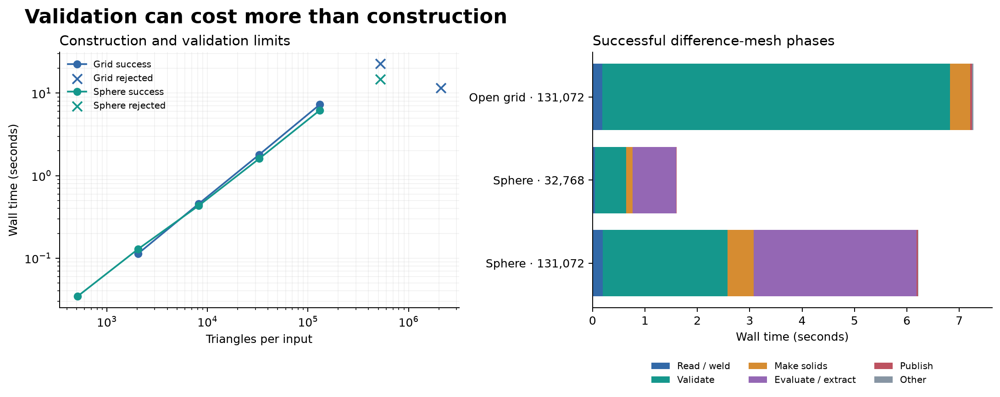
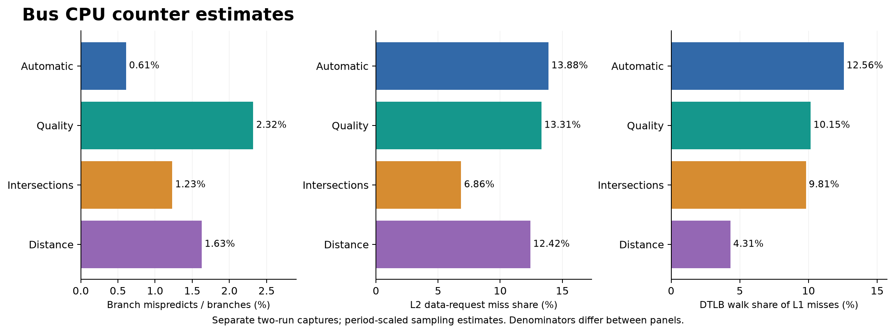
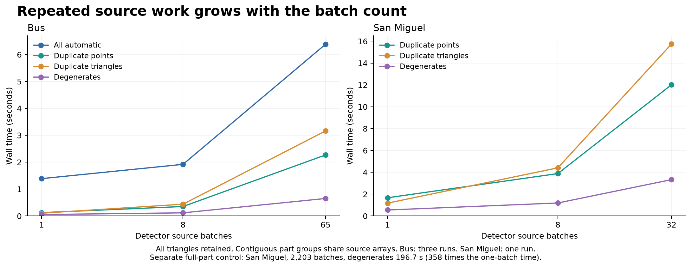

# Detector, comparison, and difference-mesh performance

This investigation measures the production CPU algorithms at commit
`61efba03137994d2597227ab0b5aaecea21545c4`. It uses the large OBJ models from
the previous performance reports. Production algorithms are unchanged. The
research harness and isolated expression and cancellation-token experiments are in
[`experiments/detector-profile`](../experiments/detector-profile/README.md).

## Main findings

- Powerplant takes 451 seconds for two-way distance. Its queries test about
  ten times as many target triangles as Bus queries. Bennu has more triangles,
  but takes 227 seconds and has a much larger serial statistics share.
- An isolated quality-helper change reduces wall time by 22–28% on three
  models. The compiled code and sampled instruction counts support the gain.
- A separate maximum-expression change reduces complete distance time by
  5.0% on Bus, 9.9% on Powerplant, and 6.5% on Bennu. The large-model controls
  each have one experimental run.
- More source batches can repeat expensive full-source work. On unchanged Bus
  geometry, automatic detection takes 1.39 seconds with one batch and 6.38
  seconds with 65 batches. San Miguel's degenerate check rises from 0.55 to
  196.72 seconds across 1 to 2,203 batches, with the same result count.
  The real Bus application also shows the source-batch cost.
- Difference validation is a major cost and a size limit. Neither imported
  shifted pairs nor clean generated inputs at 524,288 triangles per side
  complete the default difference path.
- Bear Trap reaches 33.89 GiB RSS during automatic detection. Its distance
  heatmap exceeds the current display-buffer capacity.
- Cancellation checks do not remove cleanup cost. A Bennu difference request
  made during reading/welding returns 1.61 seconds after the stop request.

## Scope and evidence

The measurements cover the nine default automatic detectors, triangle quality,
self-intersections, two-way surface distance, and difference-mesh creation. They
also cover retained geometry, source layout, worker counts, CPU affinity, query
distance, local deformation, cancellation, and the headless application path.

The retained set has 151 CPU captures: 150 complete captures and one probe
stopped because of external compiler activity. It contains 712 operation
records, 323 timing-summary rows, and 7,538 sampled-event rows. Two separate
headless application sessions cover whole-model and per-volume requests.
Errors, intentional cancellations, partial results, and noisy captures remain
in the evidence with their status.

Portable evidence is in [`benchmarks/detectors-20261017`](benchmarks/detectors-20261017).
The evidence includes individual runs, errors, result counts, stage times, memory
samples, CPU counters, query-work counts, and commands. Large profiler databases,
matching executables, PDB files, and linker maps remain under
`D:/woby-builds/detector-analysis-20261017/measurements`. Capture metadata records
their paths and SHA-256 hashes. The portable archive retains available generated
source, frozen harness source, compiler options, and dependency manifests.
The archive manifest hashes the exact file bytes. Early generation manifests
hash experimental variants as LF-normalized text; the final generator hashes
their on-disk bytes. The preserved files allow both checks.

## Test conditions

| Item | Setting |
| --- | --- |
| CPU | AMD Ryzen 7 5800H, 8 physical cores, 16 logical CPUs |
| CPU cache | 4 MiB total L2; 16 MiB L3 |
| Memory | Two 32 GiB DDR4 modules, configured at 3200 MT/s |
| OS | Windows 11 Home, build 26300; Hyper-V active |
| Build | MSVC 19.51.36243, Release, `vs2026-vcpkg` |
| Optimization | `/O2 /Ob2 /DNDEBUG`; symbols retained with `/Zi /Zo` |
| Power plan | Existing Legion Balance Mode; unchanged |
| AMD profiler | uProf 5.3.521.0 |
| Independent profiler | Intel VTune 2025.3, software hotspot sampling |
| Manifold | 3.4.1, installed build has `MANIFOLD_PAR=OFF` |

Our workloads run in sequence. Our builds, test suites, and profiler analysis
run between captures. A separate Release build starts during the first Bus
maximum-expression controls. Those timings are excluded from speedup estimates;
the affected Bennu probe is stopped and repeated. The campaign waits for the
external build, then repeats Bus with alternating controls. Compiler activity
is retained in the external-process samples and marked in the exported tables.
The observer waits 250 ms between passes, but collection
itself takes time. Actual median process-sample intervals are 1.59–1.71 seconds
in the five native captures; 95th-percentile intervals are 1.79–1.98 seconds.
Each sample has its actual timestamp. External CPU totals are a lower bound:
short-lived processes and low-activity entries can be missed. These are local
desktop measurements, not results from a controlled laboratory machine.

Measured external activity averages at least 0.80–1.05 logical CPUs during
the first four native captures. Bear Trap sees at least 1.47, including a
background download process. Those processes remain outside the probe's CPU
totals. They can still compete for shared machine resources. Small timing
differences require caution; the per-run data and final Bus repeat help check
drift.

The final native Bus repeat gives medians of 1.371 seconds for automatic
detection, 2.575 for quality, 1.098 for bounded intersections, and 7.909 for
distance. These differ from the initial medians by +0.5%, -0.3%, +1.6%, and
+0.1%, respectively. The later executable has a different hash after harness
additions; the production algorithm sources are unchanged. This repeat checks
large timing drift, but does not isolate every source of variation.

File hashes were read before the campaign. Loading is therefore not a cold-disk
test. Operation timers start after loading and pair preparation. Each operation
gets a fresh result and a live stop source. Repetitions run in the same process,
with result release timed separately. Allocator and page-cache history remain.
The report gives medians and ranges; three repetitions do not establish a
confidence interval. Large controls with one run are identified as such.

### Models and pair definition

| Model | File bytes | Generated triangles | Source points | Render vertices | Parts |
| --- | ---: | ---: | ---: | ---: | ---: |
| Bus | 75,585,857 | 1,054,542 | 535,893 | 547,469 | 65 |
| Powerplant | 817,891,724 | 12,759,246 | 5,984,083 | 10,953,627 | 21 |
| San Miguel | 1,143,041,382 | 9,980,699 | 5,933,233 | 9,021,391 | 2,203 |
| Bennu | 815,866,103 | 17,866,836 | 8,933,524 | 8,933,524 | 1 |
| Bear Trap | 7,108,991,827 | 75,771,986 | 37,890,645 | 38,414,391 | 1 |

San Miguel has 9,932,385 source faces. Polygon triangulation produces the larger
triangle count above. Use generated triangles when comparing algorithm work.

The default comparison uses the same mesh on both sides. B is shifted in Z by
0.001 times the full bounding-box diagonal. The absolute shifts are 118.689 model
units for Bus, 685.735 for Powerplant, 0.0756473 for San Miguel, and 0.000932462 for
Bennu. This is a controlled stress case. It is not an authentic repaired pair.
The same relative shift can be large compared with local triangle size. Triangle
count alone cannot explain the comparison time.

The measured median longest edge makes this difference concrete:

| Model | Median longest edge, model units | Default shift / median edge | Shape metric, fifth percentile |
| --- | ---: | ---: | ---: |
| Bus | 164.935 | 0.72 | 0.4292 |
| Powerplant | 47.0885 | 14.56 | 0.00577 |
| San Miguel | 0.0124267 | 6.09 | 0.06105 |
| Bennu | 0.000504798 | 1.85 | 0.1284 |

The shape metric approaches zero for a degenerate triangle and one for an
equilateral triangle. Powerplant has both a larger shift relative to typical
triangle size and a low-quality tail. These facts are consistent with its high
query work; this campaign does not isolate their individual causal effects.

Additional runs use zero shift, 0.00001, and 0.01 times the diagonal. A local
deformation keeps connectivity and moves B in Z within a circular XY region.
The region is centered on the first indexed vertex, with radius 0.2 times the
diagonal. The displacement is `height * (1-r*r)^2` inside the region and zero
outside. The maximum height is 0.001 times the diagonal. Capture metadata records
the number of changed vertices. This pair owns a second geometry allocation;
its preparation is outside the operation timer.

## Timing boundaries

- `auto`: nine default detectors on A. It excludes the separate quality and
  intersection operations.
- `quality`: triangle metrics, edge reduction, statistics, distributions, and
  display records on A.
- `intersections`: analysis geometry, BVH construction, traversal, and findings
  on A. Default limits are 10,000 pairs and 1,000,000 candidate tests.
- `distance`: both directed comparisons, with four samples per triangle,
  two target trees, weighted statistics, and display records.
- `difference`: validation and any construction reached by the input. An error
  is a measured rejection, not a successful Boolean result.
- `source`: shared ownership in `comparisonSourceMesh`. It does not measure
  application world-space snapshot assembly.
- `topology-warm`: recomputed findings with retained geometry and incidence.
  `intersections-warm` retains geometry but rebuilds the intersection BVH.
  Neither is an unchanged application cache hit.

Native probes provide latency. Coarse scopes identify stages. Query counters
change inner loops and are used only to count work. Selected query batches on
large models use the full target tree and retain the normal 128-face batch
order, but their distance statistics are invalid and are marked as such.
The headless application measurements include CLI and scheduling costs; they
are reported separately from CPU kernels.

Nested scope times overlap. A parent must not be added to its children.
Concurrent topology findings also overlap. Process CPU time divided by wall
time gives average active logical CPUs. It is not a percentage of all 16 CPUs.
Very short scopes have coarse Windows CPU-time resolution.
Raw scopes also record user and kernel CPU time, process I/O counters, page
faults, and Windows process-cycle counts. Page faults combine soft and hard
faults. Windows process-cycle counts are separate from the sampled PMC cycles
used for IPC; they are not used to infer clock frequency.

## Native results

| Model | Automatic detectors | Triangle quality | Bounded intersections | Two-way distance |
| --- | ---: | ---: | ---: | ---: |
| Bus | 1.364 s | 2.584 s | 1.081 s, partial | 7.904 s |
| Powerplant | 19.130 s | 26.400 s | 11.760 s, partial | 450.984 s |
| San Miguel | 17.542 s | 29.355 s | 9.103 s, partial | 281.163 s |
| Bennu | 36.135 s | 61.814 s | 23.168 s, partial | 226.628 s |
| Bear Trap | 164.199 s | 261.295 s | 74.367 s, partial | Rejected after 2.283 s |

The first four rows are medians of three runs. Bear Trap has one full run.
Individual values and min–max ranges are in `timings.csv` and the raw capture
archive. All five default intersection runs are incomplete.

The [detector-count table](benchmarks/detectors-20261017/detectors.csv) retains
all nine automatic counts for each run. Different checks use different
definitions of degeneracy. For example, Bennu has 10,679 default near-degenerate
findings, zero quality-degenerate triangles, and zero excluded collapsed faces
in the intersection check. These counts must not be treated as one metric.

| Distance workload | Median process CPU time | Median active logical CPUs | Lifetime RSS peak reached by this stage |
| --- | ---: | ---: | ---: |
| Bus | 28.06 s | 3.57 | 0.68 GiB |
| Powerplant | 3,325.50 s | 7.36 | 8.54 GiB |
| San Miguel | 1,979.05 s | 7.04 | 6.92 GiB |
| Bennu | 833.81 s | 3.68 | 11.26 GiB |

Each timing column is summarized independently. Powerplant uses about four
times Bennu's process CPU time, despite its lower triangle count. The query-work
measurements below explain much of that difference. Quality and bounded
intersection checks use approximately one active CPU. Automatic detection uses
about 1.2–1.3 CPUs on average.

Bear Trap reaches a 33.89 GiB lifetime RSS peak during automatic detection.
Its quality check takes 261.3 seconds and reaches 17.53 GiB. The full capture
finishes without triggering the 48 GiB process-memory guard.

The September detector report measured an earlier concurrent detector batch.
The current implementation deliberately runs large detector workspaces in
sequence and builds the retained topology graph last. This reduces overlapping
scratch memory. A time difference from that report is not evidence of a
regression under the same execution policy.

## CPU work and memory

Separate check requests use fresh results and the same whole-source input.
Bus entries are medians of three scoped runs; each larger-model entry has one
run. All selected detector counts agree with the combined automatic result.

| Requested checks | Bus | Powerplant | San Miguel | Bennu |
| --- | ---: | ---: | ---: | ---: |
| Duplicate points | 0.125 s | 2.289 s | 1.751 s | 2.710 s |
| Duplicate triangles | 0.112 s | 1.416 s | 1.179 s | 2.932 s |
| Both duplicate checks | 0.193 s | 3.224 s | 2.586 s | 5.017 s |
| Degenerate triangles | 0.055 s | 0.682 s | 0.572 s | 1.030 s |
| Six topology checks | 1.136 s | 14.527 s | 14.884 s | 30.100 s |

The topology row covers boundary edges, non-manifold edges, winding,
non-manifold vertices, holes, and fins. It includes shared preparation.
It is not six independent costs that can be split equally. Combining the
duplicate checks shares source work and costs less than adding their separate
request times. The degenerate check uses parallel batches; short wall time
can still consume several CPU-seconds on a large model.

Quality spends more than half its time in statistics on each measured large
model. The following scopes use the production algorithms with coarse timers.
Bus values are medians of three runs; the other rows have one run.

| Quality stage | Bus | Powerplant | San Miguel | Bennu |
| --- | ---: | ---: | ---: | ---: |
| Metrics and point welding | 0.375 s | 4.899 s | 6.270 s | 13.696 s |
| Edge sort and reduction | 0.425 s | 5.681 s | 4.307 s | 11.630 s |
| Statistics | 1.607 s | 14.080 s | 17.468 s | 33.615 s |
| Complete quality operation | 2.554 s | 26.314 s | 29.454 s | 61.729 s |

The statistics scope contains four metric sorts and the size/area ordering.
It is serial. A high arithmetic throughput alone cannot remove this cost.
The reference-token experiment below isolates one avoidable cost in this path.

Automatic detection also has substantial serial preparation. In the single
Powerplant stage run, duplicate inspection takes 3.170 seconds, analysis
geometry takes 1.634 seconds, legacy triangle diagnostics take 4.791 seconds,
and dense topology incidence takes 4.546 seconds. Current topology findings
then take 2.877 seconds. The fin, boundary, and vertex finding jobs overlap
within this last scope. Bennu spends 9.334 seconds in legacy triangle
diagnostics and 11.536 seconds in incidence construction. Sharing work between
these representations is worth testing; their source-identity rules differ.

Retained geometry does not make a detector rerun free. Bus topology findings
take 0.576 seconds with retained geometry and incidence. Powerplant takes
8.016 seconds and Bennu takes 14.556 seconds. These reruns still execute the
legacy triangle diagnostics and construct current findings. Warm intersection
checks take 0.958, 10.207, and 19.678 seconds respectively. They build a new BVH.
These measurements support investigation of reuse, but do not measure an
unchanged application cache lookup.

Retained geometry and incidence are substantial. Capacity totals below count
the recorded arrays. They exclude allocator overhead and unrelated results.

| Model | Analysis geometry | Topology incidence |
| --- | ---: | ---: |
| Bus | 72.80 MiB | 231.05 MiB |
| Powerplant | 858.00 MiB | 2,720.39 MiB |
| San Miguel | 728.44 MiB | 2,307.90 MiB |
| Bennu | 1,226.82 MiB | 3,885.50 MiB |
| Bear Trap | 5,203.06 MiB | 16,592.63 MiB |

Retaining trees or running more detector jobs can reduce latency, but can also
increase the peak working set. Any such change needs a memory budget and a
clear invalidation rule. Lifetime working-set peaks include loading and earlier
operations. The data also contain memory sampled within each operation; those
samples can miss brief peaks.

Destruction also has a measurable cost outside the operation timers. Releasing
the automatic result takes 0.609 seconds at the Powerplant median and 2.665
seconds in the Bear Trap run. Bear Trap quality release takes 0.431 seconds.
These are final-owner destruction costs in the probe. A production change that
retains or replaces large results must check which thread releases the final
owner; moving computation to a worker does not by itself move destruction.

## Quality cancellation-token control

`surface_mesh_quality.cpp` passes the stop token by value to its local
`canceled` helper. The sort comparators call this helper repeatedly. The
experiment changes only that helper parameter to `const std::stop_token&` in
a generated copy. It retains stop checks. A second control uses an empty token
with the original implementation. Empty tokens do not represent application
cancellation behavior.

| Model | Production live token | Reference helper | Less wall time | Runs, production / reference |
| --- | ---: | ---: | ---: | ---: |
| Bus | 2.569 s | 1.862 s | 27.5% | 5 / 5 |
| Powerplant | 26.710 s | 19.399 s | 27.4% | 1 / 3 |
| Bennu | 61.917 s | 48.021 s | 22.4% | 1 / 1 |

The recorded result summaries match exactly, including all four quality
statistic sets, counts, and retained-array capacities. This is not a saved
comparison of every per-face metric. The contract tests also compare native
and experimental results and check pre-canceled operations.

Bus with an empty token takes 2.486 s at the median, only 3.2% less than the live
token. Therefore, the full reference-parameter gain must not be attributed
solely to atomic reference counting. The signature can also change call and
inlining costs. The compiled-code audit shows locked increments at the original
sort call sites and a locked decrement in the called helper. The reference
build inlines the stop-state check in the inspected partition function. Its
hot path has no calls to the helper and no locked instructions. This is code
generation evidence, not a count of executed instructions or proof of lock
contention. The quality sort runs on one thread.

The reference helper with an empty token takes 1.818 seconds at the median of
five runs, 2.4% less than its live-token control. Removing cancellation state
is therefore a much smaller gain than changing the helper parameter in this
build. Keep cancellation enabled in a production change.

Sampled Bus counters support a reduction in executed work. These are means
from two original captures and three reference captures:

| Complete quality operation | Original helper | Reference helper |
| --- | ---: | ---: |
| Estimated retired instructions | 9.460 billion | 6.263 billion |
| Estimated cycles | 4.978 billion | 3.543 billion |
| Estimated branch mispredictions | 56.000 million | 56.008 million |
| Mispredictions / retired branches | 2.32% | 3.59% |

The reference build retires about 34% fewer instructions. Its branch miss
percentage rises because it executes fewer branches; the absolute estimated
misprediction count stays nearly constant. A larger miss percentage is not,
by itself, evidence that this change makes prediction worse.

## Distance maximum-expression control

Every point-to-triangle test checks whether its target triangle is degenerate.
The production expression uses `std::max({a,b,c})` for three squared edge
lengths. A separate executable changes this expression to
`std::max(std::max(a,b),c)`. It keeps the edge order, threshold, triangle
distance algorithm, and cancellation behavior. It does not precompute triangle
data or change the tree.

| Model | Baseline distance | Experimental distance | Less wall time | Runs, baseline / experiment |
| --- | ---: | ---: | ---: | ---: |
| Bus | 7.785 s | 7.395 s | 5.0% | 4 / 4 |
| Powerplant | 450.984 s | 406.127 s | 9.9% | 3 / 1 |
| Bennu | 226.628 s | 211.808 s | 6.5% | 3 / 1 |

The clean Bus baseline range is 7.736–7.876 seconds; the experimental range
is 7.313–7.460 seconds. Median process CPU time falls from 27.609 to 24.102
seconds, or 12.7%. The two query passes fall from 2.522 to 2.118 seconds,
or 16.0%, while tree construction and statistics remain separate costs.
Powerplant's experimental queries take 318.042 seconds, compared with 363.962
seconds in its earlier scoped capture. Bennu's queries take 63.200 seconds,
compared with 76.050 seconds. These stage comparisons use one run each.

The compiled degeneracy function drops from 109 to 86 listed instructions.
The original calls `__std_max_element_d_` and the stack-cookie check; the
experimental function has no direct calls. Map-delimited sizes are 448 and
416 bytes, including any padding. The caller still calls the degeneracy
function. These are static code counts, not executed instruction totals.

Clean sampled counters give the following means over three complete Bus
operations per variant:

| Complete distance operation | Baseline | Maximum-expression experiment |
| --- | ---: | ---: |
| Estimated retired instructions | 100.154 billion | 85.418 billion |
| Estimated cycles | 54.404 billion | 47.672 billion |
| Estimated branch mispredictions | 211.942 million | 206.017 million |
| Mispredictions / retired branches | 1.62% | 1.98% |
| IPC | 1.84 | 1.79 |

The experiment retires about 14.7% fewer instructions over the full operation
and 18.3% fewer in the query stages. The generic min/max helper receives about
20% of baseline query cycle samples and disappears from the top query hotspots
after the change. Tree and statistic instruction counts stay nearly constant.
IPC decreases slightly and branch-miss percentage increases, while total work
and elapsed time decrease. Neither rate alone is an optimization target.

The first Bus experiment overlaps a separate Release build. Its control sees
at least 211 CPU seconds from compiler processes. Those captures remain in the
archive but are excluded from timing comparisons. The clean Bus series uses
four new processes per variant, alternating their order. Separate clean branch
captures use three operations per variant. Powerplant and Bennu each have one
experimental run, compared with the earlier three-run native median; those
large-model estimates need more repeats before a production change.

Contract tests compare the expression variants on grids, spheres, collapsed
and collinear triangles, nearly degenerate triangles, and small and large
coordinates. They also check cancellation before computation. The large-model
checks compare complete recorded distance summaries, not every per-face value.

## Distance-tree work and parallel scaling

The distance BVH uses four children per node, median splits, and at most eight
triangles per leaf. Each aligned node occupies 256 bytes. Bounds use doubles;
the current box-distance code uses SSE2. Tree construction repeatedly computes
bounds and centroids. It runs serially. Both directed statistics passes also
run serially. Query batches share the bounded worker budget.

Each query first checks the previous sample's closest triangle. A zero-distance
hint can avoid traversal. Otherwise, the tree visits near boxes first and uses
the best distance to reject farther boxes. Source order, target geometry,
triangle size, and displacement can change the work per query.

The default shifted pair produces the following query work. Bus counts every
query. Powerplant, San Miguel, and Bennu select one 128-face batch in every
100 batches, without changing the full target tree. A second stride of 97
checks selection sensitivity on Powerplant and Bennu. These are work counts,
not latency results. Stack visits include internal nodes and leaf entries.

| Model | Queries counted, each direction | Mean stack visits, A→B / B→A | Mean triangle tests, A→B / B→A | Maximum stack visits, A→B / B→A |
| --- | ---: | ---: | ---: | ---: |
| Bus | 4,218,168 | 18.68 / 18.76 | 21.15 / 20.78 | 214 / 245 |
| Powerplant | 510,464 | 323.76 / 307.30 | 207.55 / 198.25 | 2,406 / 2,311 |
| San Miguel | 399,360 | 265.22 / 261.54 | 142.53 / 140.47 | 1,636 / 1,572 |
| Bennu | 714,752 | 25.00 / 25.13 | 39.33 / 39.36 | 88 / 88 |

Powerplant's two-direction mean is about 203 triangle tests per query. At
stride 97 it is about 206, a change of 1.3%. Its high work is not explained by
one exceptional selected batch. This check does not make the selection random.
The raw exports retain logarithmic histograms. A reported percentile bucket
is an interval, not an exact percentile.

Zero displacement does not eliminate traversal. Powerplant still averages
about 141 node visits and 77 triangle tests per query in that case. Bus at a
shift of 0.00001 times its diagonal does more query work than at the default
0.001 shift. Displacement and elapsed time do not have a simple monotonic
relationship.
San Miguel at zero displacement still averages 185 stack visits and 82
triangle tests per query. Its local-deformation control gives 122.66 / 121.49
triangle tests per query and moves 7,437,122 of its 9,021,391 render vertices.

The local-deformation control gives 20.97 / 19.83 triangle tests per query on
Bus, 424.10 / 195.93 on Powerplant, and 13.74 / 13.70 on Bennu. The same support
radius changes 290,879, 10,880,158, and 3,200,075 render vertices respectively.
It covers almost all Powerplant render vertices, so it is not a small repair
for that model. The strong A→B / B→A difference also shows why both directions
must be measured. Bus completes this pair in 7.160 seconds at the median of
three scoped runs; the large-model local-deformation runs count selected queries only.

The worker sweep uses three Bus runs per setting. Worker totals include the
calling thread. All rows retain the same batch size and results.

| Workers | Complete distance median | Two query passes median | Process CPU median |
| --- | ---: | ---: | ---: |
| 1 | 24.665 s | 19.345 s | 24.578 s |
| 2 | 15.121 s | 9.784 s | 24.734 s |
| 4 | 10.336 s | 5.049 s | 25.328 s |
| 8 | 8.055 s | 2.759 s | 27.125 s |
| 9, default | 7.806 s | 2.545 s | 27.625 s |

Queries gain about 7.6 times from one to nine workers. The full operation gains
about 3.2 times. Roughly 5.3 seconds remain outside the query passes. Two serial
tree builds and two serial statistics passes dominate this remainder. On Bus,
more query workers alone cannot remove most of the remaining latency.

Powerplant has a different balance. Its low-overhead frequency/power capture
takes 451.789 seconds for distance: 34.759 seconds in tree construction,
363.962 seconds in the query passes, and 51.507 seconds in statistics. Queries
use about 8.9 active CPUs and consume 80.6% of wall time. Reducing query work is
the largest opportunity there. Tree and statistics changes remain useful,
but cannot remove that query cost.

Bennu's corresponding trace takes 224.597 seconds: 60.553 seconds in tree
construction, 76.050 seconds in queries, and 86.010 seconds in statistics.
Its queries also use about 8.9 active CPUs, but occupy only 33.9% of total wall
time. Thus, high CPU use inside the query phase does not imply that the complete
operation has good parallel scaling.

Eight workers pinned to eight physical cores take 7.888 seconds. Eight workers
on four cores with both SMT siblings take 8.457 seconds and use 30.344 CPU
seconds. These controls support using physical cores before SMT siblings for
this kernel. They do not establish a useful gain over the default nine-worker
policy: that difference is small relative to run variation.

Shuffling triangles within each imported part increases Bus distance time to
11.068 seconds, about 40% above the native baseline. Mean node visits increase
by about 29%, while triangle tests increase by about 7%. Source order affects
hint reuse and memory access, as well as tree traversal. The measurements do
not assign the entire time change to one cause. Quality rises to 3.476 seconds,
with an identical recorded quality summary. Expanding render vertices while
retaining source provenance gives 8.064 seconds for distance and 3.023 seconds
for quality. Exact-position topology is a different identity rule, and is not
an equivalent speed setting.

Weighted P95 sorts sample indices with an index tie-breaker. A replacement must
retain area weighting and the required deterministic result. An unweighted
selection operation is not an equivalent substitute. Precomputed triangle
invariants, a different split rule, a retained tree, and vectorized kernels
remain candidates for separate measured experiments.

## Self-intersections and difference meshes

The default detector returns bounded partial results. Zero findings in a
truncated run do not establish that a mesh has no intersections. Difference
creation uses a separate limit of 5,000,000 candidate tests and stops if
validation is incomplete. It must not accept a truncated check as valid input.

Simple generated inputs separate successful construction from imported-model
rejection. `grid N` has `2*N*N` triangles and one open boundary. Two displaced
grids test closure and constructed gap volume. A generated sphere tests closed
solid subtraction. Successful grid volumes are checked against area times
separation. The sphere test checks positive A-only and B-only volumes.

All five default intersection checks are partial:

| Model | Retained intersecting pairs | Candidate tests | Collapsed faces excluded | Stop reason |
| --- | ---: | ---: | ---: | --- |
| Bus | 10,000 | 538,195 | 236 | Pair limit |
| Powerplant | 10,000 | 271,571 | 296 | Pair limit |
| San Miguel | 10,000 | 136,171 | 17,287 | Pair limit |
| Bennu | 0 | 1,000,000 | 0 | Candidate limit |
| Bear Trap | 4 | 1,000,000 | 26 | Candidate limit |

Bus completes without limits in 4.102 seconds at the median of three scoped
runs. It tests 6,953,667 candidates and finds 48,052 intersecting pairs on
23,441 affected faces. The complete Bennu counter run tests 135,160,538 pairs
and finds no intersections. It takes 103.410 seconds, including counter
instrumentation. Bennu performs 1,152,022,552 node-box tests and 301,063,876
face-box tests. The initial bounded zero result was not sufficient evidence
for this conclusion.

The classifier counters separate the fast separation filter, the adaptive
predicate, and the rational fallback. In bounded runs, the fast filter rejects
97.81% of Bus candidates, 95.34% of Powerplant candidates, and 99.9907% of Bennu
candidates. The complete Bennu run calls the adaptive path 12,275 times and
never reaches the rational fallback. Grid 256 input validation sends 195,075
of 1,107,976 candidates to the adaptive path, all returning false. The tested
sphere 256 input and output checks all finish in the fast filter. These paths
are geometry-dependent. Removing the robust fallbacks is not justified.

None of the imported default pairs produces a difference mesh. Bus rejects
collapsed input triangles after 0.003 seconds, Powerplant after 2.997 seconds,
San Miguel after 0.024 seconds, and Bear Trap after 1.490 seconds. Bennu reaches
the input intersection-validation limit after 78.297 seconds. These times
measure rejection. They must not be used as Boolean-construction benchmarks.

Bennu's reduced-frequency PMC stage captures take about 80.1 seconds. Reading
and welding input A takes 32.6–33.0 seconds. Validation takes 47.1–47.6 seconds,
including about 19.5 seconds to build the intersection tree and 2.8–3.1 seconds
to traverse it. The remaining validation work includes topology checks and
temporary geometry. Thus, removing the candidate limit alone would not remove
most of the work already paid before rejection.

The successful generated workloads show the following scaling. Each value is
the median of three scoped runs; validation errors remain separate outcomes.

| Family and size | Input triangles per side | Difference time | Outcome |
| --- | ---: | ---: | --- |
| Grid 32 | 2,048 | 0.114 s | Constructed gap volume |
| Grid 64 | 8,192 | 0.456 s | Constructed gap volume |
| Grid 128 | 32,768 | 1.798 s | Constructed gap volume |
| Grid 256 | 131,072 | 7.264 s | Constructed gap volume |
| Grid 512 | 524,288 | 22.625 s | Shell validation limit |
| Grid 1024 | 2,097,152 | 11.618 s | Input A validation limit |
| Sphere 32 | 512 | 0.034 s | A-only and B-only solids |
| Sphere 64 | 2,048 | 0.129 s | A-only and B-only solids |
| Sphere 128 | 8,192 | 0.433 s | A-only and B-only solids |
| Sphere 256 | 32,768 | 1.607 s | A-only and B-only solids |
| Sphere 512 | 131,072 | 6.197 s | A-only and B-only solids |
| Sphere 1024 | 524,288 | 14.773 s | Output validation limit |

Both clean families hit a validation limit at 524,288 input triangles per side.
Grid 1024 rejects faster than Grid 512 because it stops at an earlier stage.
This is not faster successful construction. Native controls for Grid 256 and
Sphere 256 take 7.226 and 1.587 seconds respectively.

In the first Grid 256 scoped run, input A validation takes 1.626 seconds,
input B validation takes 1.621 seconds, and shell validation takes 3.378
seconds. These checks consume about 91% of the 7.254-second operation.
Solid construction takes 0.388 seconds. The generated shell has 2,048 closure
triangles; its volume agrees with grid area times separation.

Pair placement also changes the path. Coincident Grid 128 inputs reject the
closure assumption after about 0.916 seconds. Coincident Sphere 128 inputs
produce an empty difference in about 0.355 seconds. A disjoint sphere pair at
two diagonals takes about 0.182 seconds. These controls must not be mixed with
the default small-shift workload.

The installed Manifold library has parallel execution disabled. That setting
does not by itself explain total difference time: Woby validates inputs and
generated results outside the library. The stage data identify how much time
actually reaches Manifold.

## Hardware counters

The installed CPU event definitions are from uProf's `0x19_0x5.xml`, for this
processor family and model. Each capture uses at most six core PMCs. Retired
instructions and cycles are collected with every event group. Cache, branch,
TLB, frontend, backend, and prefetch groups use separate runs; their estimates
must not be treated as simultaneous exact totals.

Counts are sample counts multiplied by event periods. Scope alignment uses QPC
timestamps and each translated capture's timeline bucket width. The long
Powerplant captures use 2 ms buckets; shorter captures use 1 ms. Treating the
bucket index as milliseconds misaligns the long captures. The analyzer checks
this metadata explicitly, and the contract suite tests both widths.
The export retains sensitivity to shifting both boundaries by
plus or minus 16 ms. It also retains sample counts, function resolution, and
event-specific hotspots. Sampling skid and inlining limit attribution to an
exact instruction. Profiler overhead is measured against native runs.
The hardware phase tables omit scopes shorter than 100 ms. Their raw captures
remain available, but a short interval can have too few samples for a useful rate.
The PMC captures select user-mode execution. OS process CPU times also include
kernel execution, so these two sets of counters have different scopes.

For the two Bus branch captures, shifting both operation boundaries by 16 ms
changes the distance instruction and cycle estimates by less than 0.06%.
The automatic-detector branch-miss estimate changes by up to 3.7%. For the
Bus data-fill captures, the distance local-DRAM estimate changes by up to 2.6%.
These checks bound sensitivity to this chosen time shift. They do not bound
all sampling error or background-load effects.

Bus has two repetitions per counter group. The table gives means of the
per-run estimates. MPKI means events per 1,000 retired instructions.

| Bus operation | IPC | Branch miss rate | Branch MPKI | L2 data-request miss share | Data-TLB walk MPKI |
| --- | ---: | ---: | ---: | ---: | ---: |
| Automatic detectors | 2.33 | 0.61% | 1.04 | 13.89% | 0.083 |
| Quality | 1.90 | 2.32% | 5.92 | 13.31% | 0.026 |
| Bounded intersections | 2.92 | 1.23% | 2.15 | 6.86% | 0.029 |
| Distance | 1.83 | 1.63% | 2.12 | 12.42% | 0.047 |

These whole-operation averages hide large stage differences:

| Bus distance stage | IPC, branch capture | Branch MPKI | L2 request miss share | Local DRAM/IO fill MPKI | Data-TLB walk MPKI |
| --- | ---: | ---: | ---: | ---: | ---: |
| Tree construction | 2.55 | 1.84 | 13.25% | 0.408 | 0.166 |
| Queries | 1.83 | 1.52 | 2.67% | 0.014 | 0.006 |
| Statistics | 1.39 | 8.03 | 38.46% | 1.490 | 0.238 |

The serial indirect statistics sort has much more cache and translation work
per instruction than the query loop. In Bus queries, 97.6% of the three
captured demand-fill sources are local L2. In Bus statistics, the split is
48.5% local L2, 36.8% L3/other L2 in the CCX, and 14.7% local DRAM/IO.
These shares describe where demand refills come from; they are not hit rates
for all loads.

Bennu statistics has an estimated IPC of 0.95 in the data capture and 6.24
local DRAM/IO fills per 1,000 instructions. Its captured demand-fill split is
26.0% / 28.5% / 45.5%. Bennu queries have IPC 1.70 and only 0.054 local DRAM/IO
fills per 1,000 instructions. This supports separate work on the serial sort
and the query kernel, with different memory-access patterns.

In Bus query scopes, symbolized cycle samples concentrate in nearest-tree
traversal, point-to-triangle distance, the repeated degeneracy check, and the
MSVC generic min/max helper. In tree construction, partitioning accounts for
about 39–40% and repeated bounds calculation for about 33–35% of cycle samples.
In quality statistics, the original stop-check helper accounts for about 40%.
These are sampled attribution shares. They are not exact exclusive elapsed
times, and an instruction-pointer sample can land after the costly operation.

The independent VTune software capture also identifies nearest-tree search,
point-to-triangle distance, box distance, degeneracy checks, and the min/max
helper. Its report splits some samples into inlined C++ and library functions;
for example, stop-token destruction appears separately from the enclosing
helper. The exported VTune table covers the complete capture, including load
and all operations, so its percentages must not be compared directly with a
single uProf stage. Some system DLL symbols are unavailable.

Additional core events give useful limits on the interpretation:

- Conditional direction mismatches account for almost all measured Bus branch
  misses. Indirect-branch misses are near the sampling floor.
- Bus tree construction records load-queue dispatch stalls on about 22% of
  sampled cycles. The corresponding query estimate is about 2.3%. The serial
  statistics stage records integer-scheduler resource stalls on about 11%.
  These events overlap other effects and do not form a complete stall budget.
- Quality statistics records an empty operation queue on about 8% of cycles.
  Instruction-cache and instruction-TLB sample counts are low. They do not
  support a claim that instruction-cache capacity is the main quality cost.
- Bus query hardware prefetches record about 2.69 L2 hits, 0.18 L3 hits after
  an L2 miss, and 0.15 misses in both caches per 1,000 instructions. These
  events do not establish how many prefetches are useful or wasted.
- Some TLB intervals have very few samples. For example, each quality
  statistics interval has only two to four walk samples. A large ratio from
  such a small denominator is weak evidence. Zero sampled events are not
  proof that no events occurred.

Bus PMC captures take 8.81–9.28 seconds for distance, compared with the native
7.90 seconds. This is about 11–17% overhead. The reduced-frequency Bennu data
capture takes 228.91 seconds, close to the 226.63-second native median. Use
the native timings for latency and the counter runs for event estimates.

The Powerplant stage alignment gives the following estimates. Each
event group has one long capture; the two directed stages are averaged.

| Powerplant distance stage | IPC, branch capture | Branch MPKI | Local DRAM/IO fill MPKI |
| --- | ---: | ---: | ---: |
| Tree construction | 2.11 | 2.17 | 0.935 |
| Queries | 1.77 | 0.51 | 0.011 |
| Statistics | 1.11 | 9.65 | 4.258 |

The complete operation retires an estimated 11.46 trillion instructions;
11.20 trillion are in queries. The query demand-fill split is 90.2% local L2,
9.7% L3/other L2, and 0.12% local DRAM/IO. Nearest-tree traversal receives about
49% of query cycle samples, the generic min/max helper 15%, triangle distance
14%, and the degeneracy check 12%. Query branch misses are only about 0.40%
of retired branches. The high elapsed time comes with much more executed query
work; it is not evidence of a high branch-miss rate.

Powerplant statistics has a 34.2% / 28.2% / 37.5% demand-fill split and a
3.73% branch-miss rate. As on Bus and Bennu, the serial sort has a different
CPU and memory profile from the parallel query loop. These core events do not
measure total memory bandwidth or establish bandwidth saturation.

Bennu difference reading/welding has IPC about 1.05 and 2.49 local DRAM/IO
demand fills per 1,000 instructions. About 74.7% of its 1,266 DRAM-fill samples
land in the ordered-map lower-bound lookup used to weld positions. Its
captured fill sources split 52.2% local L2, 10.3% L3/other L2, and 37.5% local
DRAM/IO. This is direct evidence to test a compact lookup representation for
exact-position welding. Preserve exact position equality and stable output
indexing. The samples do not measure exact load latency.

The Bus math capture records about 573 SSE-family instructions per 1,000
retired instructions in distance queries. This family includes moves and
nonnumeric instructions, so 57.3% is not a FLOP rate or SIMD utilization.
The `ExDivBusy` event estimates 2.26% of query cycles, and `ExDivCount` about
1.75 events per 1,000 instructions. The installed definitions do not describe
the integer/floating-point coverage of these divide events. They must not be
treated as a complete floating-point divide-stall budget. The quality-statistic
scopes record no divide samples at these periods; that is not proof of zero
divide operations.

The shuffled-face controls confirm a substantial change in memory access.
These values are means from two captures per event group. IPC comes from the
data-fill capture; the L2 request rate comes from its separate event group.

| Bus stage | Original / shuffled IPC | Original / shuffled L2 request miss share | Original / shuffled local DRAM/IO fill MPKI |
| --- | ---: | ---: | ---: |
| Complete quality | 1.91 / 1.49 | 13.31% / 35.54% | 0.197 / 1.219 |
| Distance queries | 1.83 / 1.55 | 2.67% / 17.93% | 0.014 / 0.378 |
| Distance statistics | 1.38 / 1.25 | 38.45% / 43.04% | 1.490 / 2.627 |

The query DRAM-fill estimate uses 92 samples in the original captures and
2,640 in the shuffled captures. The much larger rate supports a loss of
locality as well as the separately measured increase in traversal work. It
does not assign the full elapsed-time increase to cache misses. Quality result
summaries remain equal after shuffling within parts.

The explicit HighQoS frequency capture still reports about 1.979 GHz during
queries. It does not show a higher query frequency in this environment.

The frequency captures report about 1.98 GHz during the parallel distance
queries on Bus, Powerplant, and Bennu. A separate Windows counter records
1,990 MHz during Powerplant work. AC power is connected. The recorded power
plan allows a 100% maximum processor state, has no explicit maximum-frequency
cap, and enables boost. These readings do not identify the cause of the low
observed frequency. No thermal-throttling cause is established.

An isolated process-policy control explicitly disables execution-speed
throttling for the probe. It uses the Windows
[SetProcessInformation power-throttling API](https://learn.microsoft.com/en-us/windows/win32/api/processthreadsapi/nf-processthreadsapi-setprocessinformation).
It changes no other process or system power setting. The default control has
`ControlMask=0, StateMask=0`; the explicit control has `ControlMask=1,
StateMask=0`. Three unprofiled runs per setting give these Bus medians:

| Operation | Default process policy | Explicit HighQoS |
| --- | ---: | ---: |
| Automatic detectors | 1.409 s | 1.375 s |
| Quality | 2.606 s | 2.576 s |
| Bounded intersections | 1.094 s | 1.086 s |
| Distance | 7.809 s | 7.961 s |

The policy change does not produce a consistent latency gain. All recorded
distance and quality results agree. The separate HighQoS frequency capture
overlaps the start of external build activity, so its latency is not a clean
comparison.

System-wide package power during queries averages 12.94 W on Bus, 13.32 W on
Powerplant, and 13.35 W on Bennu. During serial distance statistics, the values
are 7.39 W, 6.76 W, and 6.68 W. These are 100 ms system samples, not energy
attributed only to the probe. Other processes and idle cores affect them.
Non-finite frequency values from inactive sampling intervals are excluded and
counted in the exported data.

| Event group | Meaning and limit |
| --- | --- |
| Branches | Retired branches, all mispredictions, direction-mismatch mispredictions, and indirect-branch mispredictions. Mispredict rate uses retired branches as its denominator. |
| Data fills | Captured demand fills from local L2, L3 or another L2 in the same CCX, and local DRAM/IO. These are refill sources, not a general cache hit rate. |
| L2 requests | Data request hit and miss events. The reported miss share excludes L2 prefetch requests. |
| TLB | L1 data-TLB misses that hit L2, and L2 data-TLB misses that require a walk. The walk share uses those L1 misses as its denominator, not all loads. |
| Alignment | Misaligned loads that cross a cache line or a page. |
| Frontend | Instruction-cache fills from L2/system, empty operation queue cycles, and selected instruction-TLB walks. |
| Backend | Dispatch stalls associated with load/store queues, integer register resources, and scheduler resources. Events can overlap. They are not a complete pipeline partition. |
| Prefetch | Hardware prefetch requests that hit L2, miss L2 and hit L3, or miss both. These do not count all memory traffic. |
| Math | Retired SSE-family instructions, divide operations, and divide busy cycles. SSE-family counts include nonnumeric instructions; they do not measure FLOPs or SIMD lane use. |

Core PMC sampling is available. IBS, L3, data-fabric, and memory-controller
sampling are unavailable in the installed environment. Exact load latency,
complete DRAM bandwidth, and precise L3 hit rates therefore remain unmeasured.
WPR was also tried. It failed to enable the performance-profile policy with
error `0xc5585011`; the raw error is retained. No recording started, and no OS
policy was changed. The absence of these measurements is not a zero result.

For the profiler's event and collection semantics, see the
[AMD uProf user guide](https://docs.amd.com/r/en-US/57368-uProf-user-guide),
[hardware sources](https://docs.amd.com/r/en-US/57368-uProf-user-guide/Hardware-Sources),
and [core PMC events](https://docs.amd.com/r/en-US/57368-uProf-user-guide/7.9.1.2.-Predefined-Core-PMC-Events).
The locally captured event XML is the source for the exact masks used here.

## Cancellation and application behavior

Bus cancellation controls use three runs at each request delay. The following
values are the observed min–max return delays after the actual request.

| Requested delay | Automatic detectors | Quality | Intersections | Distance |
| --- | ---: | ---: | ---: | ---: |
| 50 ms | 0.2–0.6 ms | 5.2–6.1 ms | 2.9–3.2 ms | 5.1–5.2 ms |
| 500 ms | 6.3–6.6 ms | 28.6–33.6 ms | 7.4–7.8 ms | 7.2–7.4 ms |
| 1,500 ms | Finished first | 29.5–31.0 ms | Finished first | 11.8–13.9 ms |
| 3,000 ms | Finished first | Finished first | Finished first | 21.6–22.5 ms |

The timer can issue its request later than the configured delay. For example,
500 ms requests occur at 505–515 ms in these runs. The return-delay calculation
uses the recorded request timestamp, so timer scheduling delay is not charged
to cancellation response.

Bennu difference creation receives its stop request at 30.005 seconds and
returns 1.613 seconds later in the single large cancellation run. The request
occurs during input reading/welding. Returning from this path also destroys the
large partially built maps and arrays. A frequent stop check therefore does
not guarantee a short visible return delay on a large model.

Three late-cancellation runs test library work. Grid 256 receives its request
at 6.902–6.915 seconds, during `difference_mesh.solid`, and returns 264–361 ms
later. Sphere 512 receives its request at 4.509–4.515 seconds, during
`difference_mesh.output`, and returns 889–941 ms later. These functions do not
receive Woby's stop token. The output function triggers lazy Boolean evaluation
and extracts the resulting mesh. The measured return delay also includes
cleanup after the library call returns.

The real headless viewer is tested through its CLI in two source-grouping
modes. The following timings include command startup, scheduling, snapshot
preparation, any required computation or upload, and response serialization.
The automatic timer ends only when all nine detectors are current. It includes
the nine small findings requests used to confirm that condition.

| Bus application request | Whole model | Per volume | Runs per mode |
| --- | ---: | ---: | ---: |
| Automatic results ready | 2.159 s | 7.039 s | 3 |
| Quality and full result response, after automatic results | 2.997 s | 2.990 s | 3 |
| Manual bounded intersections ready, retained geometry | 1.072 s | 0.545 s | 3 |
| Cached full result response | 0.401 s | 0.446 s | 3 |
| Analysis deletion acknowledged | 0.053 s | 0.052 s | 3 |
| Identical-pair full result response | 15.667 s | 25.451 s | 1 |
| Identical-pair difference rejection | 0.312 s | 0.313 s | 1 |

Whole-model automatic counts match the standalone probe. Per-volume mode
reports 496 duplicate points instead of 510; the other eight automatic counts
match on Bus. Source grouping changes the domain of a check. It is not an
equivalent performance setting. Both manual intersection requests reach the
pair limit: whole mode tests 538,195 candidates and per-volume mode 538,196.
Their shorter per-volume time does not establish a faster complete check.

The two-sided application pair is identical, with zero displacement. Its full
result request includes both sides' quality and automatic detectors as well
as distance. The timer starts after analysis creation is acknowledged, so a
small amount of preparation can start before it. Do not compare this request
directly with the shifted-pair distance kernel. Both difference requests reject
collapsed input triangles. Deletion timing ends at acknowledgment; it does not
prove that every retained allocation has already been released.

The application logs put one-sided quality CPU preparation at 2.512–2.562
seconds. Quality upload takes 17.6–39.9 ms. The largest logged headless frame is
350.9 ms in whole mode and 352.2 ms in per-volume mode. These are engine-frame
measurements, not interactive frame-rate measurements. They justify a separate
check of synchronous result serialization and publication. Cached full-result
queries themselves consume about 0.20–0.22 seconds of viewer CPU at the median.

A direct source-batch sweep reproduces the automatic slowdown. It keeps all
Bus triangles and partitions the imported parts into 1, 8, or 65 contiguous
source batches. All batches share the original source arrays. Times below are
medians of three scoped runs. The 65-batch automatic counts match the
per-volume application counts on Bus.

| Bus check | 1 batch | 8 batches | 65 batches |
| --- | ---: | ---: | ---: |
| All automatic detectors | 1.389 s | 1.920 s | 6.382 s |
| Duplicate points only | 0.125 s | 0.353 s | 2.268 s |
| Duplicate triangles only | 0.104 s | 0.439 s | 3.161 s |
| Degenerates only | 0.055 s | 0.118 s | 0.651 s |
| Topology only | 1.113 s | 1.221 s | 2.002 s |

Source inspection explains repeated work: `inspectDuplicates`,
`inspectDegenerates`, and topology source construction check the full shared
point/index arrays for each batch. Some scratch arrays also use the full
source-point count. The selected triangles stay fixed while this work grows
with the number of batches. Cache immutable source validation and use selected
point storage where suitable; preserve the separate detection domains.

The standalone 65-batch intersection check takes 1.326 seconds because it
includes fresh geometry preparation. The application request reuses retained
geometry. Both produce the same bounded counts on Bus. The source-batch control
does not implement hierarchy-root merging for arbitrary imported scene trees.
It changes detector source records only. Application world-mesh assembly and
render-vertex batch tags are outside this control.

San Miguel repeats the pattern with all 9,980,699 triangles retained. Each
entry below has one run; its 2,203 imported parts are grouped into the listed
number of contiguous batches.

| San Miguel check | 1 batch | 8 batches | 32 batches |
| --- | ---: | ---: | ---: |
| Duplicate points | 1.671 s | 3.885 s | 12.011 s |
| Duplicate triangles | 1.177 s | 4.410 s | 15.740 s |
| Degenerates | 0.550 s | 1.192 s | 3.328 s |

The final control uses one source batch for every imported part. Each entry
has one run, with all triangles retained:

| Degenerate check | One batch | Every part separate | Time ratio | Process CPU, one / all batches |
| --- | ---: | ---: | ---: | ---: |
| Powerplant, 21 parts | 0.682 s | 2.919 s | 4.3 times | 4.391 / 6.547 s |
| San Miguel, 2,203 parts | 0.550 s | 196.716 s | 357.7 times | 3.438 / 199.031 s |

Powerplant still reports 60,814 degenerate triangles. San Miguel still reports
31,343. San Miguel's average active CPU count falls from about 6.25 to 1.01.
The repeated serial source validation dominates this case. Increasing the
triangle-worker count cannot remove that repeated input scan.

Cancellation delay is measured from the actual stop request to return from the
operation, including stack cleanup. A job that finishes before the request is
not a cancellation sample. Difference operations can spend time inside library
calls that do not poll Woby's stop token.

## Recommended next work

| Priority | Work | Evidence and required checks |
| --- | --- | --- |
| 1 | Change the quality stop-check helper to take a const reference. | The isolated build saves 22–28% on three models. Retain cancellation and result-equivalence tests. Check the complete caller path before a production patch. |
| 2 | Replace the measured three-value maximum expression in the distance degeneracy check. | The isolated expression reduces full comparison time by 5.0–9.9% on three models. Repeat the large controls and retain precision, degenerate-triangle, and cancellation tests. |
| 3 | Validate immutable source arrays once and avoid full-source scratch arrays for each part. | Bus automatic time rises from 1.39 to 6.38 seconds across 1 to 65 batches. The application and San Miguel controls reproduce the pattern. Keep separate detection domains and source ownership. |
| 4 | Reduce distance-tree query work, especially on Powerplant. | Its default sampled query tests about ten times as many triangles as Bus. Compare split rules, leaf sizes, and triangle invariants with the same full inputs. Preserve precision and degenerate-triangle behavior. |
| 5 | Reduce or reuse serial distance preparation and statistics. | Bus retains about 5.3 seconds of serial work across the worker sweep. Test retained trees and deterministic weighted-statistic algorithms. Budget the retained memory explicitly. |
| 6 | Rework difference validation before tuning Boolean execution. | Simple valid meshes hit the candidate limit. Reuse suitable geometry and tree data, and test cheaper robust handling of common contact cases. Preserve exact fallback decisions and reject incomplete validation. |
| 7 | Test a compact exact-position welding lookup. | Bennu difference reading/welding takes about 33 seconds; ordered-map lookup receives about 75% of its sampled local DRAM/IO fills. Preserve exact equality, output order, and cancellation. |
| 8 | Check distance capacity before rebasing a large second input. | Bear Trap spends 2.28 seconds before rejecting the heatmap size. A cheap preflight can avoid preparing geometry that cannot be displayed. A statistics-only path would require a separate result design. |
| 9 | Check whether automatic detectors can share more topology work. | Legacy triangle diagnostics and retained incidence both have substantial cost. Their identity and provenance rules must be compared before one can replace the other. |
| 10 | Check synchronous application result publication and serialization. | Cached Bus result requests use about 0.20–0.22 CPU seconds; the headless log records frames up to 352 ms. Measure the interactive path and keep expensive work off the UI thread. |

Do not increase detector concurrency without measuring peak memory. Do not
remove validation limits without a replacement cost and cancellation policy.
Do not drop robust predicate fallbacks, area weights, or deterministic ordering
to make a benchmark faster. Test SIMD and cache-layout changes after identifying
the affected phase; the current measurements do not establish their speedup.

Further validation needs an authentic original/repaired pair and another CPU
or OS configuration. Precise memory latency and total DRAM bandwidth require an
environment that exposes the missing hardware sources. These gaps are separate
from the measurements completed on this machine.

## Validation and reproduction

The Release build succeeds with `vs2026-vcpkg` and no compiler warnings. This
includes the viewer, application tests, all five detector probes, and the
additional executables required by the registered unit tests.

- All 1,294 application test cases pass, with 17,501,238 assertions. Nine
  opt-in benchmark cases remain skipped in this unit run.
- All 20 detector-probe contract tests pass. They cover result equivalence,
  geometry controls, cancellation, source batches, profiler time alignment,
  incomplete-capture handling, structured exports, and source-anchor drift.
- All 18 separate registered unit-test entries pass, including the existing
  research contracts and native allocation/command tests.
- All 31 captured-result comparison groups pass. The archive preserves their
  exact scope and the incomplete capture excluded from those checks.
- Python syntax checks and `git diff --check` pass. The production `src`
  directory has no changes.

Build logs, test logs, check results, and their hashes are retained under
`validation/` in the raw evidence archive. All eight PNG figures were inspected.
The interactive report was checked at desktop and phone widths, in light and
dark themes, with all tabs and operation selections exercised.

Build and collection commands are in the
[probe README](../experiments/detector-profile/README.md). Each capture metadata
file stores its exact command. Use a new capture name; the runner refuses to
replace existing evidence. `matrix.py --list` prints each campaign. Run hardware
analysis after the measured workloads have stopped. Use `evidence.py` to export
the compact data, and `plots.py` to regenerate figures.

The report does not claim cold-cache behavior, a general hardware-independent
speedup, or throughput on an authentic repaired model. Those require separate
inputs or machines. It does identify current costs, limits, and measured causal
controls on the supplied large-model corpus.
